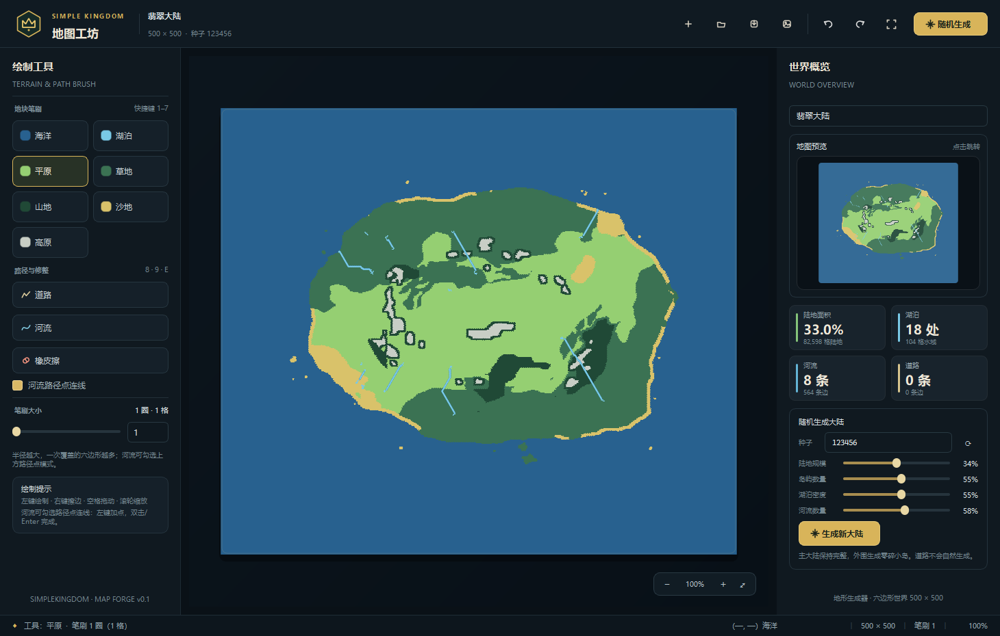

# SimpleKingdom

一个用 **Python + PyQt6** 制作的沙盒王国经营游戏。

项目目前还在早期开发阶段，只实现到“世界地图”这一模块。仓库里的地图编辑器是开发期工具，用来查看和调整游戏世界。



## 当前进度

- 500 × 500 尖顶六边形世界地图，七种地块。
- 随机生成主大陆、岛屿、地形、湖泊与顺流河流。
- 道路和河流都以六边形边链保存，可逐边绘制，也可用路径点自动连线。
- 地块、道路、河流分层存储，同一区域可以同时有道路和河流。
- 小地图、缩放、撤销/重做、PNG 导出。
- `.skmap` 地图存档，支持旧版本存档迁移。

## 运行

```bash
pip install -r requirements.txt
python main.py
```

Windows 下也可以直接双击 `run.bat`。

环境要求：Python 3.10+、PyQt6、NumPy。

## 操作

| 操作 | 功能 |
| --- | --- |
| `1`–`7` | 切换地块笔刷 |
| `8` / `9` | 道路 / 河流工具 |
| `E` | 橡皮擦 |
| 左键 / 右键 | 绘制 / 擦除 |
| 空格 + 拖动 | 平移地图 |
| 滚轮 | 缩放 |
| `Ctrl+Z` / `Ctrl+Y` | 撤销 / 重做 |
| `Ctrl+G` | 随机生成地图 |
| `Ctrl+S` / `Ctrl+O` | 保存 / 打开 |

河流路径点模式：左键加点，`Enter` 或双击完成，`Backspace` 撤点，`Esc` 取消。

## 项目结构

```text
SimpleKindom/
├─ main.py
├─ run.bat
├─ requirements.txt
├─ simplekingdom/      # 地图、生成、编辑、渲染与存档
├─ tests/              # 核心规则测试
└─ docs/               # README 截图
```

## 测试

```bash
python -m unittest discover -s tests -v
```

## 后续方向

地图模块完成后，继续接入游戏主循环：

1. 王国、城市与领地。
2. 人口、资源、税收与生产链。
3. 建筑、运输与河流航行。
4. 季节、灾害、外交与战争。
5. 从 `.skmap` 载入游戏世界。
