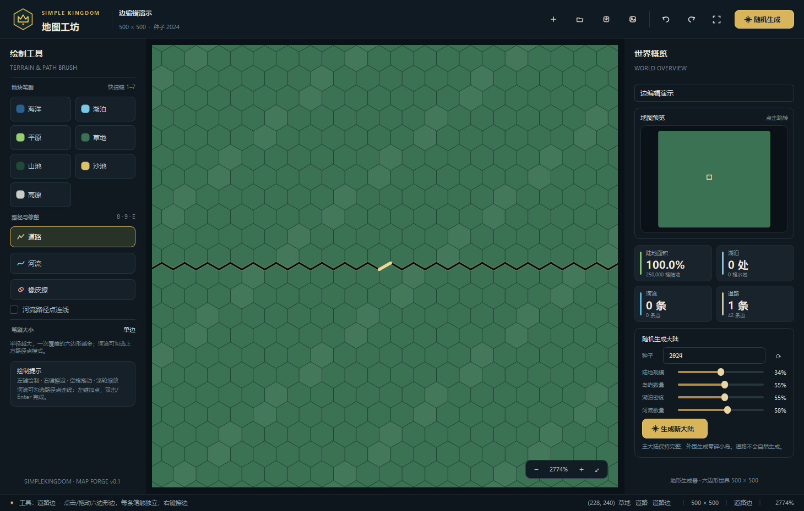
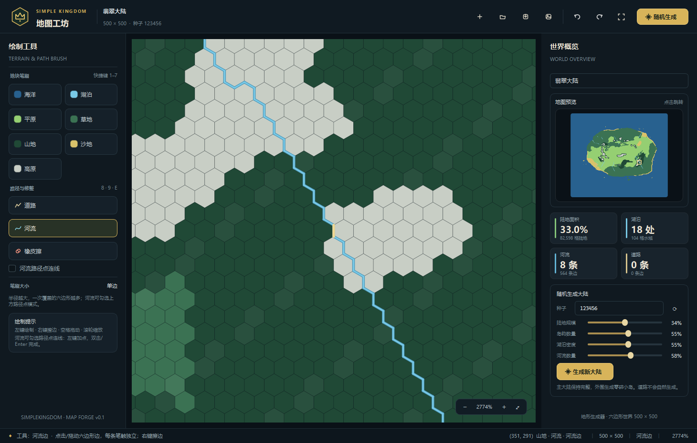
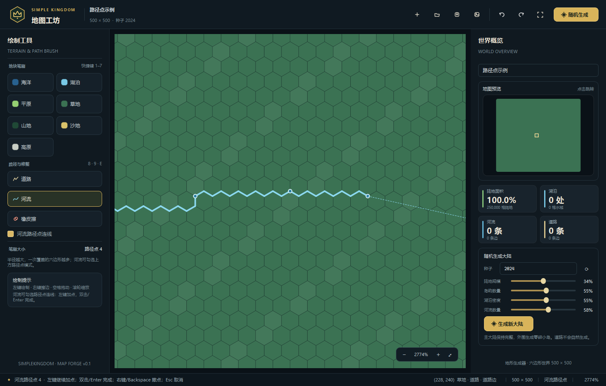

# SimpleKingdom · 地图工坊

一个用 **Python + PyQt6** 制作的沙盒王国经营游戏的地图编辑器原型。

当前版本聚焦于 **500 × 500 六边形世界地图** 的绘制、随机生成、道路/河流边编辑、
小地图导航、撤销重做与地图存档。后续可以在这个地图编辑器的基础上继续加入
王国经营、资源、人口、建筑与外交等系统。


道路和河流都直接编辑六边形的边，边链本身就是路径：



河流边链示意：



---

## 运行

环境要求：

- Python 3.10+
- PyQt6
- NumPy

安装依赖并启动：

```bash
pip install -r requirements.txt
python main.py
```

Windows 下也可以直接双击 `run.bat`。

---

## 已实现功能

### 地图

- 500 × 500 尖顶六边形地图，odd-r 偏移坐标。
- 七种地块：
  - 海洋（蓝色）
  - 湖泊（浅蓝色）
  - 平原（浅绿色）
  - 草地（墨绿色）
  - 山地（深绿色）
  - 沙地（黄色）
  - 高原（灰白色）
- 初始地图全部为海洋。
- 道路与河流都使用六边形边链保存，可以出现在同一区域。

### 道路 / 河流

道路和河流使用同一种编辑方式：

- **直接点击或拖动六边形的边**，选中的边链本身就是道路或河流；
- 每次笔触形成一条独立道路/河流分组，支流、岔路不会互相合并；
- 每条边都会归属到一个相邻六边形：先对边链计算曲率圆，记录全部曲率圆，
  选择半径最大的有限圆圆心，再把边归给离该圆心更近的一侧；
- 没有有效曲率圆时（例如直线边链），边归属于鼠标绘制时所在的一侧；
- 道路为黑色；河流由深蓝色包边和浅蓝色内芯组成，内芯颜色与湖泊一致；
- 道路和河流都属于边层，不填充地块；
- 随机生成器不会自然生成道路。

河流还可以切换为 **路径点连线**：左键放置路径点，程序自动沿六边形边连接，
双击或 Enter 完成，右键/Backspace 撤回最后一个点，Esc 取消。



### 地图编辑器

- 地块笔刷：七种地块任意切换。
- 道路边工具、河流边工具、河流路径点模式、橡皮擦。
- 地块/橡皮擦笔刷大小 1–10 圈；道路/河流工具直接选中单条边。
- 左键绘制；道路/河流工具下右键擦边；橡皮擦按范围清除地块、河流边和道路边。
- 河流路径点模式：左键加点，双击/Enter 完成，右键/Backspace 撤点，Esc 取消。
- 中键拖动 / 空格 + 左键拖动平移。
- 滚轮以光标为中心缩放，右下角缩放控件。
- 适应窗口、撤销、重做、自动网格、悬停边/笔刷预览。
- 小地图预览，点击/拖动小地图快速跳转。
- 地图名称、种子、陆地比例、湖泊数、独立河流/道路条数、
  河流边数与道路边数统计。
- 压缩二进制地图存档 `.skmap`，支持打开、另存为、导出 PNG。
- 绘制操作均可撤销，包括边编辑和整张随机地图的替换。

### 随机地形生成

随机生成器满足以下规则：

- 生成一块完整主大陆，外围散布零碎小岛。
- 平原可大面积铺展。
- 草地可成片，也可零散分布。
- 山地由高频山脊噪声形成多个山脉，并限制单个连通块尺寸。
- 高原是高而平缓的核心，外围生成连续山地环；由山地包裹高原，
  而不是高原环绕山地；高原连通块限制在 7–520 格。
- 沙地既有内陆斑块，也有沿海岸线分布的条状沙带。
- 湖泊由随机低洼处生长，单块连续格数不超过 10。
- 河流只从湖泊边缘出发，沿地势下降，最终流入海洋、其他湖泊或已有河流。
- 河流寻路严格拒绝逆流，保证整条河道从高处流向低处。
- 每条生成河流都会转换为一条独立边链；汇流处不会把支流并入主流。
- 道路不会自然出现。

生成过程在后台线程执行，并显示进度；相同种子和参数可以复现相同地图。

---

## 快捷键

| 快捷键 | 功能 |
| --- | --- |
| `1`–`7` | 切换七种地块笔刷 |
| `8` | 道路边工具 |
| `9` | 河流边工具 |
| `E` / `0` | 橡皮擦 |
| `Enter` | 路径点模式下完成河流 |
| `Backspace` | 路径点模式下撤回最后一个点 |
| `Esc` | 取消当前路径点或未完成的笔画 |
| `[` / `]` | 减小 / 增大笔刷 |
| `Ctrl+Z` | 撤销 |
| `Ctrl+Y` / `Ctrl+Shift+Z` | 重做 |
| `Ctrl+N` | 新建地图 |
| `Ctrl+O` | 打开地图 |
| `Ctrl+S` | 保存 |
| `Ctrl+Shift+S` | 另存为 |
| `Ctrl+E` | 导出 PNG |
| `Ctrl+G` | 随机生成 |
| `Ctrl+0` / `F` | 适应窗口 |

鼠标操作：左键绘制/拖边，右键擦边，中键或空格 + 左键拖动平移，滚轮缩放。

---

## 项目结构

```text
SimpleKindom/
├─ main.py                       # 程序入口
├─ run.bat                       # Windows 启动脚本
├─ requirements.txt
├─ simplekingdom/
│  ├─ constants.py               # 地块、颜色、覆盖层定义
│  ├─ hexmath.py                 # 六边形几何、邻接、坐标转换
│  ├─ edgegeom.py                # 六边形边的身份、相邻格、岸边转换
│  ├─ model.py                   # 地图数据、独立道路/河流边链、边归属
│  ├─ generator.py               # 大陆、岛屿、地形、湖泊、河流生成
│  ├─ render.py                  # 低倍率缓存与高倍率逐格渲染
│  ├─ canvas.py                  # 编辑画布、地块笔刷与边编辑
│  ├─ commands.py                # QUndoCommand 撤销/重做
│  ├─ storage.py                 # .skmap 压缩存档
│  ├─ widgets.py                 # 小地图、图标、统计卡等自绘组件
│  ├─ style.py                   # Qt 样式表
│  └─ ui.py                      # 主窗口与编辑器面板
├─ tests/
│  └─ test_core.py               # 边归属、道路/河流分组、生成规则、存档测试
└─ docs/
   ├─ screenshot.png
   ├─ editor_zoom.png
   ├─ river_edges.png
   └─ river_path_points.png
```

---

## 测试

```bash
python -m unittest discover -s tests -v
```

测试覆盖：

- 道路和河流直接由边链构成，不再生成两岸或外轮廓。
- 曲率圆最大半径圆心决定边的内侧六边形归属。
- 支流/岔路与主河/主路是独立边链，不会合并计算。
- 单独删除河流边或道路边时同步修剪相关分组。
- 单格可以同时拥有道路边和河流边。
- 旧版格子道路/河流会自动迁移为边链。
- 完整主大陆与零碎小岛。
- 湖泊最大连续格数不超过 10。
- 河流起点邻接湖泊、终点接水/河流。
- 河流高度严格不上升。
- 相同种子生成结果可复现。
- 高原外围由山地包裹，而不是高原包裹山地。
- 路径点连线会生成首尾相接的连续边链。
- 地图存档读写往返，并保留独立道路/河流边链与归属。
- 旧版 v1/v2/v3 存档自动迁移为边链。

---

## 后续开发方向

这个编辑器是游戏的第一块地基。后续可以逐步加入：

1. 地图上的王国、城市、道路运输与河流航行。
2. 资源分布、人口增长、税收与生产链。
3. 建筑放置、领地扩张与边界冲突。
4. 季节、灾害、外交和战争。
5. 从编辑器生成的 `.skmap` 直接载入游戏世界。

当前 `.skmap` 与编辑器数据层已经为后续游戏逻辑保留了独立的地块层、道路边链层和河流边链层。
